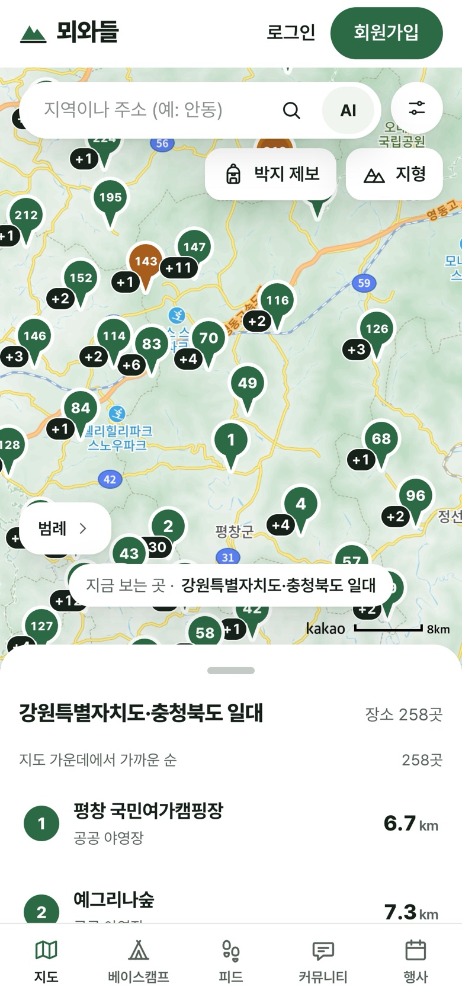
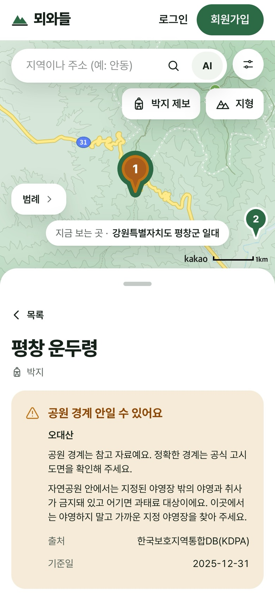
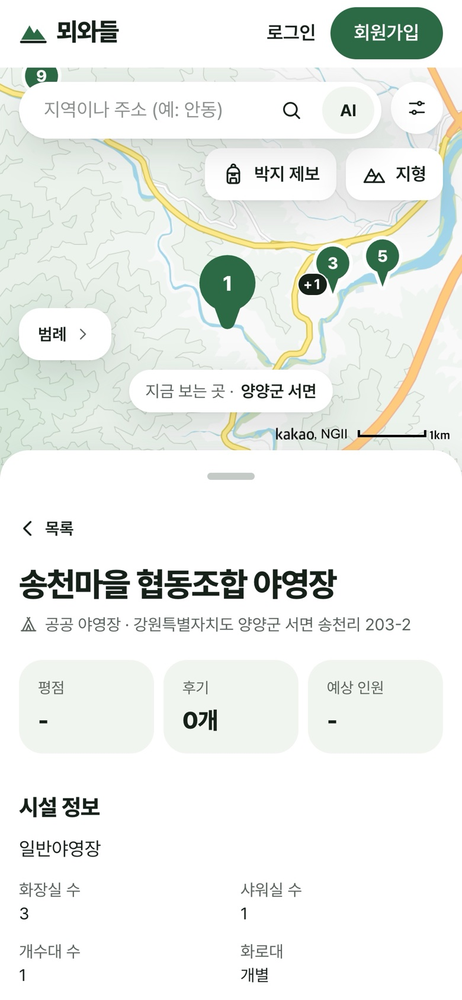
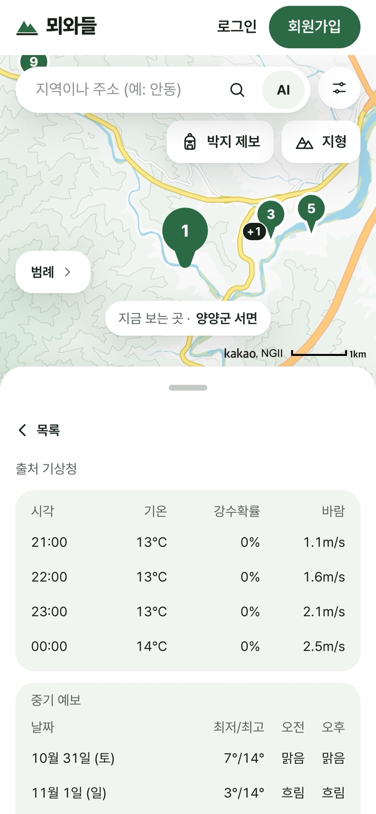
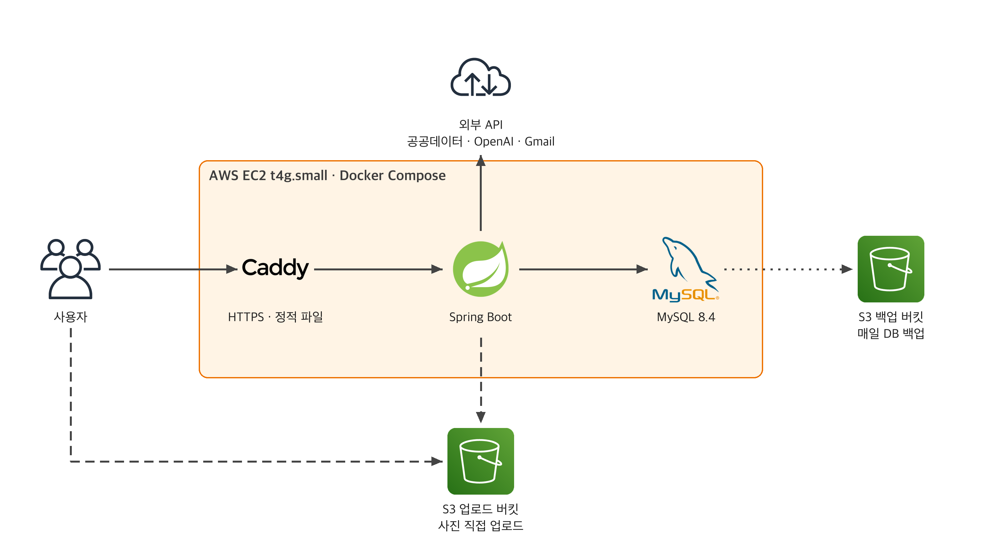
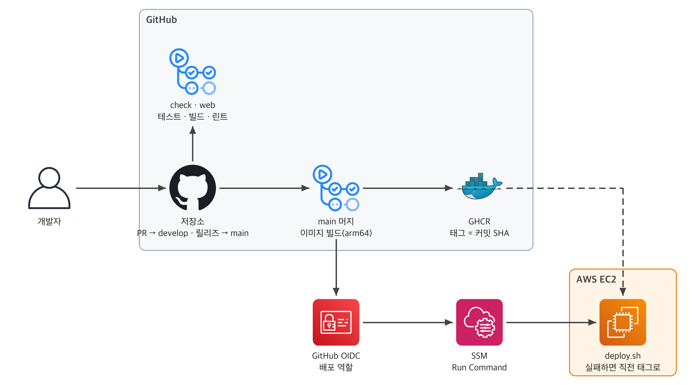

## 💚 뫼와들 사용해 보기 -> [moewadeul.duckdns.org](https://moewadeul.duckdns.org)

# ⛺ 뫼와들 (moewadeul)

> 백패커가 합법적인 박지를 찾고 믿을 수 있는 동행과 함께 가는 서비스

## 📝 프로젝트 소개
> 뫼와들은 지도에서 야영지를 찾고, 그 장소로 가는 동행(베이스캠프)을 꾸리고, 공식 백패킹 행사에 선착순으로 신청하는 웹 서비스입니다.  
박지마다 공원 경계 경고와 데이터 출처·기준일을 보여 주고, 본인확인과 신뢰 단계로 믿을 수 있는 동행을 고를 수 있습니다.

||||
|:---------:|:---------:|:---------:|
|**랜딩**|**지도**|**공원 경계 경고**|

|||
|:---------:|:---------:|
|**장소 상세**|**날씨·일몰**|

## 🛠 기술 스택

- **Backend**: Java 25, Spring Boot 4.1, Spring Data JPA, MyBatis, MySQL 8.4, Flyway, Spring Security(세션)
- **Frontend**: React, TypeScript, Vite, Tailwind CSS, 카카오맵
- **Infra**: AWS EC2·S3·SSM, Docker Compose, Caddy, GitHub Actions, Grafana Cloud

## 인프라 아키텍처


## CI/CD


## 🚀 로컬 실행

```bash
cp .env.example .env      # DB_PASSWORD, DB_ROOT_PASSWORD, CI_HMAC_KEY 등을 채웁니다
docker compose up -d      # mysql이 healthy가 될 때까지 기다립니다
./gradlew bootRun         # http://localhost:8080/swagger-ui/index.html

cd web && npm install && npm run dev   # http://localhost:5173
```

- 지도를 보려면 `.env`의 `VITE_KAKAO_JS_KEY`가 필요합니다. 나머지 변수는 `.env.example`의 주석을 참고하세요.
- 테스트: `./gradlew test`(Docker 불필요), `./gradlew integrationTest`(Docker 필요), `./gradlew check`(전체), `cd web && npm test`
- 3306 포트가 이미 쓰이면 `.env`의 `DB_PORT`를 바꿉니다. DB 비밀번호를 바꿨다면 `mysql-data/`를 지우고 다시 띄웁니다.

## 📑 데이터 출처

한국관광공사 고캠핑, 한국보호지역 통합DB관리시스템(KDPA, 법적 효력이 없는 참고 자료), 산림청 국립자연휴양림, 전국휴양림표준데이터, 기상청, 한국천문연구원(이상 공공데이터포털)
