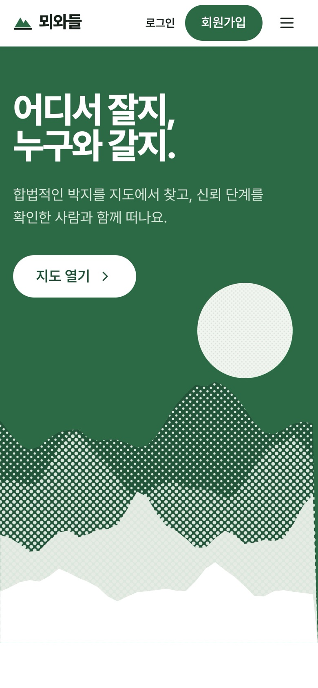
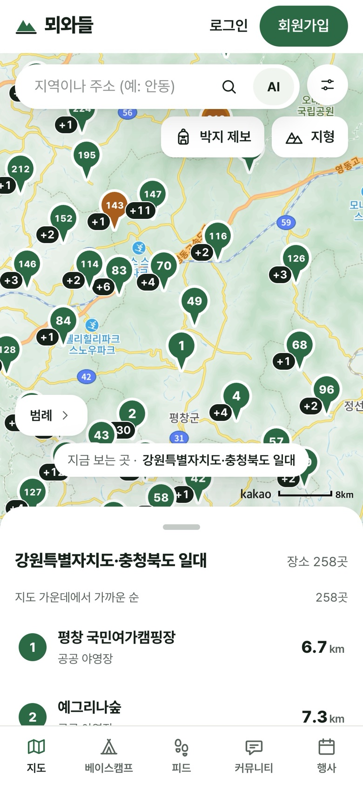
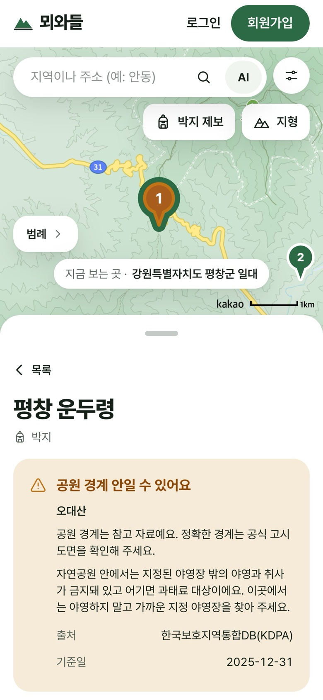
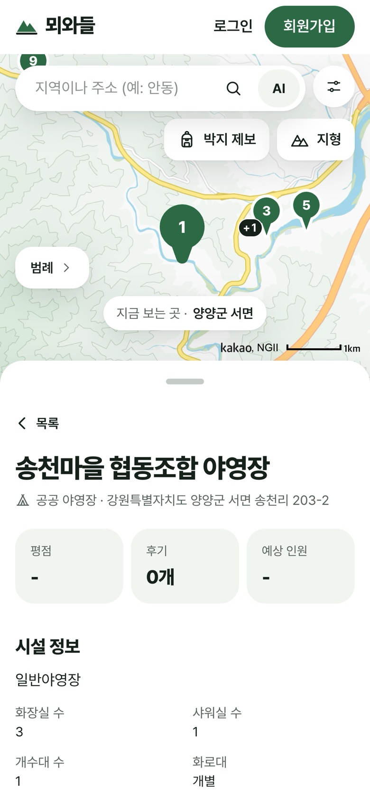
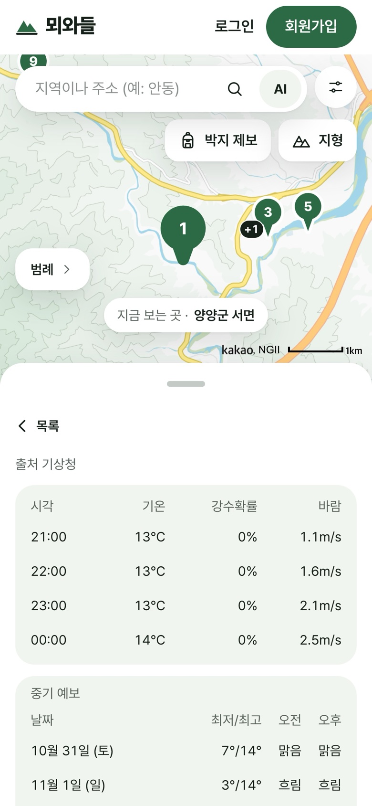
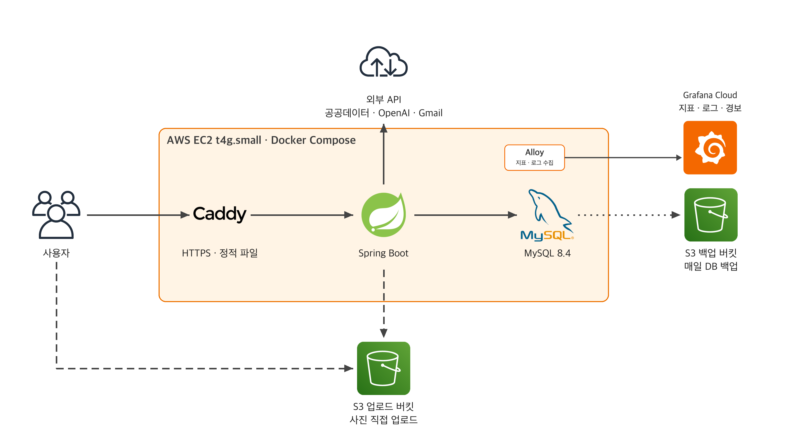
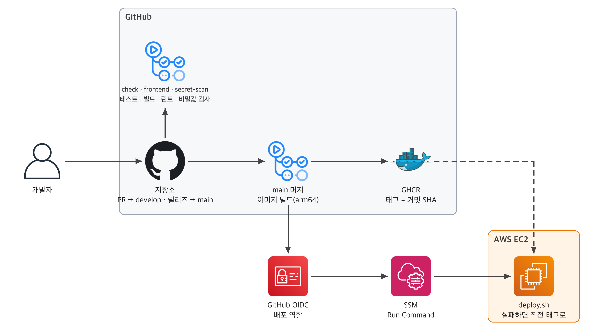

<div align="center">

# ⛺ 뫼와들

**백패커가 합법적인 박지를 찾고, 믿을 수 있는 동행과 함께 가는 서비스**

[](https://moewadeul.duckdns.org)

</div>

<br>

## 📝 프로젝트 소개

자연공원 안에서 지정된 곳 밖에 텐트를 치면 과태료를 냅니다. 그런데 블로그나 장소 공유 앱의 박지 정보에는 그곳이 공원 경계 안인지 판단할 근거가 없습니다. 동행을 구할 때도 문제가 있습니다. 낯선 사람과 산에서 하룻밤을 보내야 해서 상대를 믿을 수 있는지가 중요한데, 카페 모집 글만으로는 확인하기 어렵습니다.

뫼와들은 지도에서 야영지를 찾고, 그 장소로 가는 동행(베이스캠프)을 꾸리고, 공식 백패킹 행사에 선착순으로 신청하는 웹 서비스입니다. 박지마다 공원 경계 경고와 데이터 출처·기준일을 보여 주고, 본인확인과 동행 이력으로 매긴 신뢰 단계를 보고 동행을 고를 수 있게 합니다.

## ✨ 주요 기능

||||
|:---:|:---:|:---:|
|**랜딩**|**지도**|**공원 경계 경고**|

|||
|:---:|:---:|
|**장소 상세**|**날씨·일몰**|

- **지도에서 야영지 찾기.** 공공 야영장, 자연휴양림, 회원이 제보한 박지를 한 지도에서 봅니다. 지역 이름이나 주소로 찾을 수 있고, AI 검색을 켜면 "강원도 계곡 옆 박지" 같은 문장을 OpenAI가 검색 조건으로 바꿔 줍니다. 지도를 움직이면 보이는 범위의 장소를 다시 불러옵니다.
- **공원 경계 경고와 출처 표시.** 박지가 자연공원 경계 안에 있으면 야영·취사 금지 경고를 띄웁니다. 장소마다 어느 공공데이터에서 왔고 언제 기준인지 함께 보여 줍니다.
- **장소 상세, 날씨·일몰.** 장소 정보와 회원 후기·평점, 기상청 단기예보, 일출·일몰 시각을 한 화면에서 확인합니다.
- **베이스캠프(동행 모집).** 장소와 날짜를 정해 동행을 모집합니다. 캠프 리더는 최소 신뢰 단계, 연령대, 동성만 같은 합류 조건을 걸 수 있습니다. 동행이 끝나면 서로 후기를 남깁니다.
- **신뢰 단계.** 이메일 인증(0단계), 본인확인을 마친 성인(1단계), 동행 3회 이상에 "다시 동행하고 싶어요" 비율 80% 이상이고, 최근 180일 동안 출발 48시간 안에 동행에서 빠진 일이 3회 미만이며 확정된 제재가 없는 회원(2단계)으로 나눕니다. 단계는 저장해 두지 않고 매번 조건으로 계산하므로, 제재가 확정되면 그 즉시 반영됩니다.
- **공식 행사 선착순 신청.** 지자체나 브랜드가 여는 백패킹 행사에 선착순으로 신청합니다. 신청 오픈 순간에 수천 건이 몰려도 정원보다 많이 받지 않고, 자리가 다 차면 빈자리 알림을 신청할 수 있습니다.
- **커뮤니티와 추억 기록.** 백패킹 경험이나 장비 소개 글을 쓰고, 다녀온 곳을 사진과 함께 피드에 남깁니다.
- **신고와 제재, 알림.** 회원·박지·글·댓글·추억 기록을 신고하면 관리자가 검토해 처리합니다. 합류 승인이나 행사 결과는 웹 알림함과 이메일로 받습니다.

> **본인확인과 결제는 시연용입니다.** 실제 본인확인기관이나 결제 기관에 연결하지 않고, 입력한 값을 그대로 쓰며, 돈이 오가지 않습니다. 실제 신분증이나 카드 정보를 입력하지 마세요. 운영 사이트는 포트폴리오 시연을 위해 가짜 본인확인 공급자를 켜 두었고(`IDENTITY_FAKE_PROVIDER_ENABLED=true`), 끄면 본인확인 요청이 503으로 끝납니다.

## 🛠 기술 스택

**Backend**


**Frontend**


**Infra**


## ⚙️ 인프라 아키텍처



## 🔀 CI/CD



## 📂 디렉터리 구조

```
moewadeul
├── backend    # Spring Boot 서버, 로컬 MySQL compose, 부하 검증 스크립트
├── frontend   # React 웹 앱
├── deploy     # 운영 서버 compose, 배포 스크립트, Caddy, 백업, Alloy·Grafana 설정
└── .github    # CI·배포 워크플로, 이슈·PR 템플릿
```

## 🚀 로컬 실행

```bash
cd backend
cp .env.example .env      # DB_PASSWORD, DB_ROOT_PASSWORD, CI_HMAC_KEY, MAIL_SECRET_HMAC_KEY 등을 채웁니다
docker compose up -d      # mysql이 healthy가 될 때까지 기다립니다
./gradlew bootRun         # http://localhost:8080/swagger-ui/index.html

cd ../frontend
npm install && npm run dev   # http://localhost:5173
```

- 백엔드, compose, 프론트엔드가 모두 `backend/.env` 하나를 읽습니다. 지도를 보려면 `VITE_KAKAO_JS_KEY`가 필요하고, 나머지 변수는 `.env.example`의 주석을 참고하세요.
- 테스트는 `backend/`에서 `./gradlew test`(Docker 불필요), `./gradlew integrationTest`(Docker 필요), `./gradlew check`(전체)로 돌립니다. 프론트엔드는 `frontend/`에서 `npm test`입니다.
- 3306 포트가 이미 쓰이면 `.env`의 `DB_PORT`를 바꿉니다. DB 비밀번호를 바꿨다면 `backend/mysql-data/`를 지우고 다시 띄웁니다.

## 📑 데이터 출처

한국관광공사 고캠핑, 한국보호지역 통합DB관리시스템(KDPA, 법적 효력이 없는 참고 자료), 산림청 국립자연휴양림, 전국휴양림표준데이터, 기상청, 한국천문연구원(이상 공공데이터포털)
